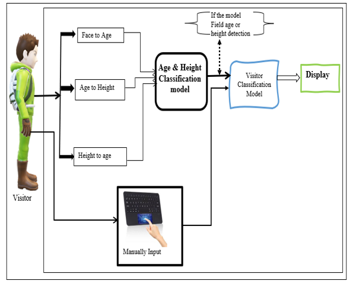

# System Architecture & Technical Specifications

## 1. Multimodal Visitor Classification Architecture

Below is the official system architecture diagram published in the CRC Press book chapter:



### Architectural Flowchart:
```
                             [ Visitor ]
                                  │
         ┌────────────────────────┼────────────────────────┐
         │                        │                        │
         ▼                        ▼                        ▼
 ┌───────────────┐        ┌───────────────┐        ┌───────────────┐
 │  Face to Age  │        │ Age to Height │        │ Height to Age │
 └───────┬───────┘        └───────┬───────┘        └───────┬───────┘
         │                        │                        │
         └────────────────────────┼────────────────────────┘
                                  ▼
                    ┌───────────────────────────┐
                    │  Age & Height             │
                    │  Classification Model     │
                    └─────────────┬─────────────┘
                                  │
         ┌────────────────────────┴────────────────────────┐
         │ (If model fails age or height detection)         │
         ▼                                                 │
 ┌───────────────┐                                         │
 │ Manual Input  │                                         │
 │ (Touchpad/UI) │                                         │
 └───────┬───────┘                                         │
         │                                                 │
         └────────────────────────┬────────────────────────┘
                                  ▼
                    ┌───────────────────────────┐
                    │   Visitor Classification  │
                    │   Model Fusion            │
                    └─────────────┬─────────────┘
                                  │
                                  ▼
                         ═════════════════
                            [ Display ]
                         ═════════════════
```

---

## 2. Core Functional Modules

### A. Face to Age
Extracts localized facial regions, computes facial morphology and texture variance, and categorizes the visitor into initial age brackets.

### B. Height to Age
Uses MediaPipe Pose skeletal keypoints to calculate standing vertical stature (distance from top of head to heels calibrated to floor camera perspective). Matches the physical height against empirical demographic percentiles.

### C. Age to Height Cross-Validation
Ensures physiological consistency between facial age estimation and physical stature.

### D. Manual Input Fallback
If the camera view is occluded, lighting is poor, or detection confidence falls below threshold, the system provides a seamless touchscreen/keyboard fallback input interface so the exhibit never fails to respond.

### E. Visitor Classification Model & Display Routing
Merges the multi-modal evidence into a final audience profile and streams tailored interactive media, typography scale, and narrative depth to the physical museum display.
