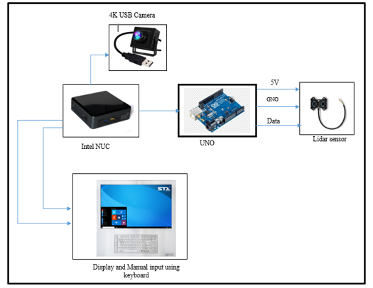

# System Architecture & Technical Specifications

## 1. Physical Hardware Components & Interfacing Topology

Below is the official hardware configuration and sensor interfacing architecture diagram:



### Hardware Interfacing Specifications:

| Component | Role / Specification | Interfacing Protocol |
| :--- | :--- | :--- |
| **Intel NUC** | Central Edge Computing Host running the computer vision and visitor classification pipeline | Host Controller |
| **4K USB Camera** | High-resolution optical video feed for real-time facial feature extraction and MediaPipe skeletal tracking | USB 3.0 / UVC Video Stream |
| **Arduino UNO** | Dedicated real-time microcontroller managing sensor telemetry and signal acquisition | USB Serial (UART @ 115200 baud) |
| **LiDAR Sensor** | Optical time-of-flight distance sensor for precise visitor range measurements (5V, GND, Data) | Digital PWM / I2C via Arduino |
| **Display & Keyboard** | Public exhibit monitor displaying personalized multimedia + physical input fallback | HDMI / DisplayPort + USB HID |

---

## 2. Multimodal Visitor Classification Architecture

Below is the visitor classification and decision fusion architecture:


### Architectural Data Flow:
```
                             [ Visitor ]
                                  │
         ┌────────────────────────┼────────────────────────┐
         │                        │                        │
         ▼                        ▼                        ▼
 ┌───────────────┐        ┌───────────────┐        ┌───────────────┐
 │  Face to Age  │        │ Age to Height │        │ Height to Age │
 └───────┬───────┘        └───────┬───────┘        └───────┬───────┘
         │                        │                        │
         └────────────────────────┼────────────────────────┘
                                  ▼
                    ┌───────────────────────────┐
                    │  Age & Height             │
                    │  Classification Model     │
                    └─────────────┬─────────────┘
                                  │
         ┌────────────────────────┴────────────────────────┐
         │ (If model fails age or height detection)         │
         ▼                                                 │
 ┌───────────────┐                                         │
 │ Manual Input  │                                         │
 │ (Touchpad/UI) │                                         │
 └───────┬───────┘                                         │
         │                                                 │
         └────────────────────────┬────────────────────────┘
                                  ▼
                    ┌───────────────────────────┐
                    │   Visitor Classification  │
                    │   Model Fusion            │
                    └─────────────┬─────────────┘
                                  │
                                  ▼
                         ═════════════════
                            [ Display ]
                         ═════════════════
```

---

## 3. Core Functional Modules

### A. Face to Age
Extracts localized facial regions, computes facial morphology and texture variance, and categorizes the visitor into initial age brackets.

### B. Height to Age (Skeletal & LiDAR Fusion)
Combines MediaPipe Pose vertical skeletal landmarks with high-precision LiDAR distance telemetry to compute accurate visitor stature.

### C. Age to Height Cross-Validation
Ensures physiological consistency between facial age estimation and physical stature.

### D. Manual Input Fallback
If the camera view is occluded, lighting is poor, or detection confidence falls below threshold, the system provides a seamless touchscreen/keyboard fallback input interface (`1: Child`, `2: Youth`, `3: Adult`, `4: Senior`).

### E. Visitor Classification Model & Display Routing
Merges the multi-modal evidence into a final audience profile and streams tailored interactive media, typography scale, and narrative depth to the physical museum display.
